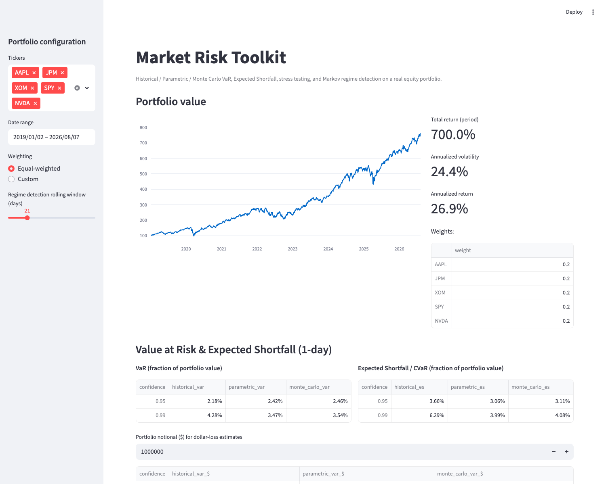
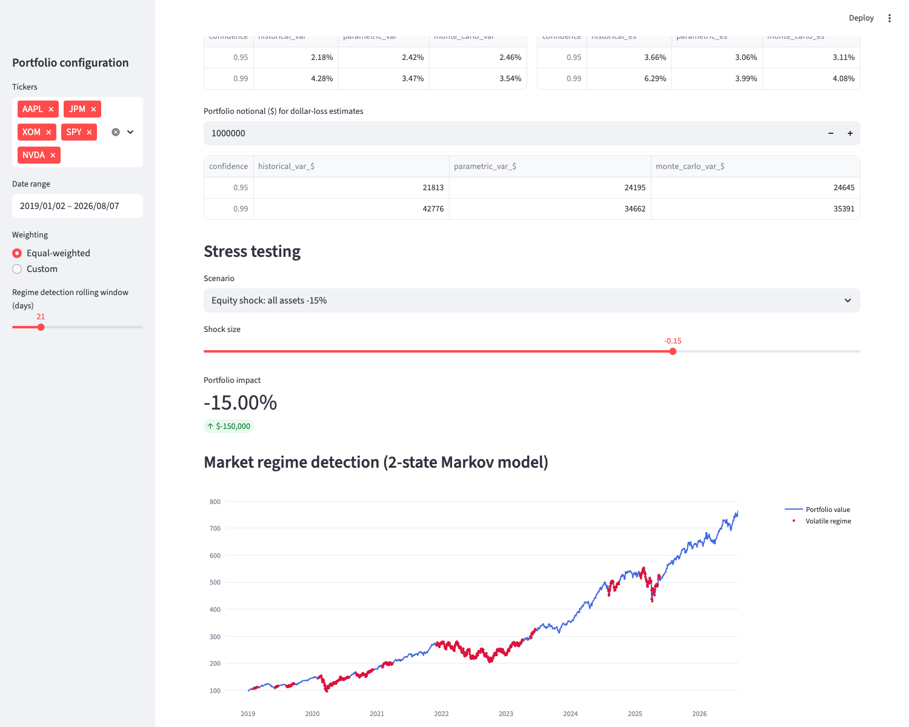
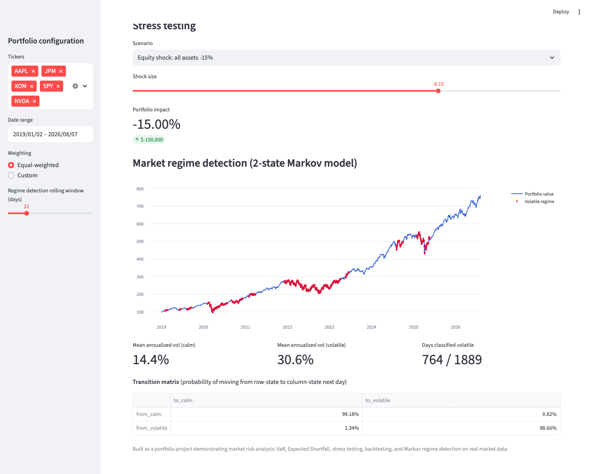
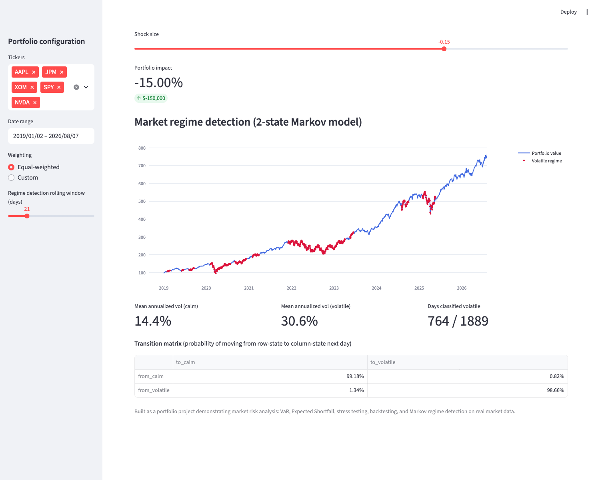

# market-risk-toolkit

Measuring how much a portfolio could lose, and how, before it happens.

## Why I built this

I studied Economics and Industrial Engineering, and along the way picked up Python, R, SQL, and a fair amount of stochastic modeling — Markov chains, Poisson processes, that kind of thing, mostly from an Operations Research course. I've used those tools on real problems since: modeling how competitors react to price changes closely enough that a pricing team adopted the monitoring windows I built, and quantifying what a churn model was actually worth in retention and revenue at a bank.

Somewhere in there I also took a Financial Markets and Institutions elective — equities, bonds, futures, options — just because I wanted to understand how markets actually work, not because it was required. I liked it enough that I kept reading about markets and risk on my own afterward. This project is what happens when that curiosity meets the fact that I already know how to build things: instead of just reading about VaR and Expected Shortfall, I wanted to actually compute them on real prices and see what they look like.

## What it does

- Value at Risk (VaR) via three methods: historical simulation, parametric, and Monte Carlo
- Expected Shortfall / CVaR
- Scenario stress testing: equity shock, volatility spike, correlation breakdown
- Simple Markov-based regime detection: calm vs. volatile market states
- VaR backtesting against realized returns

## Quick look

Portfolio overview — value over time, weights, and headline stats:



VaR and Expected Shortfall at 95%/99%, three methods side by side:



Stress testing a scenario, with the regime chart underneath it:



Regime detection — calm vs. volatile days flagged on the price series, plus the transition matrix:



## How it works

**Value at Risk** is an estimate of the most a portfolio is likely to lose over a given period, at a given confidence level — like "there's a 95% chance you won't lose more than $X tomorrow." It doesn't tell you what happens in the worst 5% of cases, just where that line sits.

**Expected Shortfall** picks up where VaR leaves off. It answers "okay, but if we do land in that bad 5%, how bad is it on average?" It's a more honest number for tail risk because it doesn't stop at the threshold.

**Stress testing** skips the statistics and just asks "what if X happens?" — a market-wide drop, a volatility spike, all your assets suddenly moving together instead of offsetting each other. It's a way of checking assumptions the historical data might not have tested yet.

**Regime detection** tries to label each period of market history as roughly "calm" or "volatile," and estimates how likely the market is to switch between the two. It's a small application of the same Markov chain logic I first ran into in an operations research context, just pointed at prices instead of queues.

## Setup

```bash
pip install -r requirements.txt
```

Run the analysis notebook:

```bash
jupyter notebook notebooks/01_full_analysis.ipynb
```

Run the interactive dashboard:

```bash
streamlit run app/dashboard.py
```

## Methodology & limitations

Parametric VaR assumes returns are normally distributed, which real markets aren't — fat tails and sudden jumps are exactly the events VaR is supposed to warn you about, and this method underestimates them. Historical VaR only knows what's already happened, so it's blind to a shock the data hasn't seen yet. The regime detector is a plain 2-state Gaussian HMM, not a many-regime production system — it's a first approximation of "calm vs. volatile," not a forecasting tool. None of this is meant to be traded on. It's meant to be understood.

## Tech stack

Python, pandas, numpy, yfinance, scipy, plotly, streamlit
